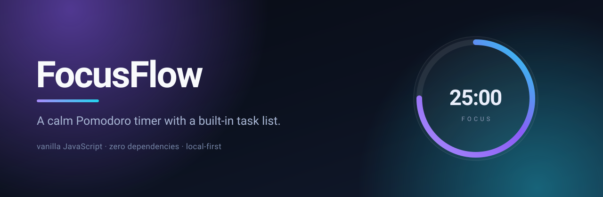

<div align="center">



# FocusFlow

**Focus in 25-minute blocks.** A calm, local-first Pomodoro timer with a built-in task list.

[**Live demo**](https://panz-08.github.io/FirstProject/) · [Report a bug](https://github.com/Panz-08/FirstProject/issues) · [Request a feature](https://github.com/Panz-08/FirstProject/issues)

[](https://github.com/Panz-08/FirstProject/actions/workflows/ci.yml)
[](https://github.com/Panz-08/FirstProject/actions/workflows/pages.yml)
[](LICENSE)
[](package.json)
[](package.json)

</div>

---

## Why another Pomodoro timer?

Most timers want an account, a subscription, or a network connection before
they will count down from 25:00. FocusFlow is one static page with no build
step, no framework, and no tracking. Everything you type stays in your
browser's `localStorage` — there is no backend to send it to.

It is also a small, readable reference for how far you can get with plain
HTML, CSS, and modern JavaScript when the state machine is kept separate from
the DOM.

## Features

- **Pomodoro cycle that keeps count** — 25 / 5 / 15 minute blocks, with a long
  break automatically offered after every fourth completed focus session.
- **Built-in task list** — add, complete, reopen, delete, and clear tasks.
  Tasks survive reloads.
- **Today's stats** — sessions completed and total focused time, reset at
  local midnight.
- **Wall-clock accurate** — the countdown is anchored to `Date.now()`, so it
  stays correct even when the tab is throttled or the screen sleeps.
- **Dark and light themes** — remembers your choice, otherwise follows
  `prefers-color-scheme`.
- **Keyboard first** — `Space` to start or pause, `R` reset, `S` skip,
  `N` new task, `T` theme.
- **Accessible** — semantic landmarks, visible focus rings, a skip link,
  `aria-live` announcements, and reduced-motion support.
- **Zero dependencies** — no `node_modules` needed to run or test the app.

## Keyboard shortcuts

| Key     | Action                       |
| ------- | ---------------------------- |
| `Space` | Start / pause the timer      |
| `R`     | Reset the current block      |
| `S`     | Skip to the next block       |
| `N`     | Jump to the task input       |
| `T`     | Toggle dark / light theme    |
| `←` `→` | Move between timer modes     |

Shortcuts are ignored while you are typing in the task input.

## Run it locally

FocusFlow is a static site, so any file server works:

```bash
git clone https://github.com/Panz-08/FirstProject.git
cd FirstProject
npm start          # python3 -m http.server 4173
```

Then open <http://localhost:4173>.

There is no install step and no bundler. Opening `index.html` directly works
too, although a server is recommended so ES modules load with the right MIME
type.

## Tests

The timer, task model, formatting helpers, and storage wrapper are pure
modules, so they can be tested without a browser:

```bash
npm test
```

The suite uses the built-in `node:test` runner — 34 tests, no dependencies.
CI runs the same command on Node 22 and 24 for every push and pull request.

## Project structure

```text
FirstProject/
├── index.html                 # single page shell
├── assets/
│   ├── banner.svg             # README banner
│   ├── favicon.svg
│   ├── css/style.css          # design tokens + layout
│   └── js/
│       ├── main.js            # DOM wiring, events, persistence
│       ├── timer.js           # Pomodoro state machine (no DOM)
│       ├── tasks.js           # immutable task list operations
│       ├── storage.js         # safe JSON wrapper around localStorage
│       └── format.js          # clock, duration, and date helpers
├── tests/                     # node:test suites
└── .github/workflows/         # CI + GitHub Pages deployment
```

### How the timer stays testable

`PomodoroTimer` never calls `setInterval` and never reads the clock itself.
Every method takes a `now` timestamp, and the UI decides when to call `tick()`.
That keeps the cycle logic deterministic:

```js
const timer = new PomodoroTimer();
timer.start(Date.now());
timer.tick(Date.now()); // returns { mode, finished } once the block ends
timer.complete();       // records the session, returns the next mode
```

## Deployment

Pushes to `main` are built and published to GitHub Pages by
[`pages.yml`](.github/workflows/pages.yml). The workflow copies `index.html`
and `assets/` into an artifact — no build step, no secrets.

## Data and privacy

FocusFlow stores three keys in `localStorage`: `focusflow:tasks`,
`focusflow:timer`, and `focusflow:stats` (plus `focusflow:theme`). Nothing is
sent over the network. Clearing site data resets the app.

## License

[MIT](LICENSE) © 2026 Panz-08
